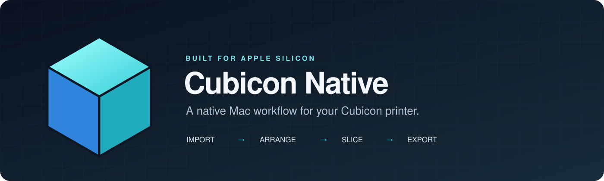
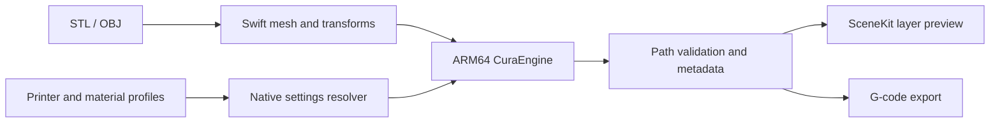

<p align="center"></p>

<p align="center">
  <a href="https://github.com/aimyr/cubicon-native/actions/workflows/native.yml"></a>
  
  
  <a href="LICENSE"></a>
</p>

# Cubicon Native

A native Mac workflow for Cubicon printers: import a model, adjust its placement and print settings, inspect generated layers, and export G-code.

Built by [Aimer](https://github.com/aimyr) with **Swift, AppKit and SceneKit**, backed by a bundled **ARM64 CuraEngine**. The application runs directly on Apple Silicon, without Wine or Rosetta.

## Features

- Import binary/text STL and OBJ models.
- Move, rotate and scale models in a 3D build-volume preview.
- Center a model, place it on the bed and check its printable bounds.
- Select Single Plus or Style Plus A15 profiles and PLA, ABS or PETG material presets.
- Adjust layer height, first layer, infill, temperature, speed and supports.
- Slice asynchronously, inspect individual toolpath layers and export G-code.
- Use the same native pipeline from the command line.

## Supported printers

| Profile | Build volume | Profile source |
| --- | --- | --- |
| Cubicon Single Plus / 3DP-310F | 240 × 190 × 200 mm | Cubicon R&D Center definitions in Cura |
| Cubicon Style Plus A15 | 150 × 150 × 150 mm | Cubicon R&D Center definitions in Cura |

The profiles preserve Cubicon start/end commands and nozzle offsets. Generated extrusion paths are checked against the selected build volume before export.

## Build and run

Requirements: **Apple Silicon**, **macOS 14.6+**, **Xcode Command Line Tools**, and **Python 3.11+** for the build scripts.

```sh
git clone https://github.com/aimyr/cubicon-native.git
cd cubicon-native
make build
make open
```

The app is created at `build/Cubicon Native.app`. The first build downloads the official Cura 5.13.0 ARM64 installer, verifies its SHA-256, and extracts the engine with its five required libraries. It does not install the Cura desktop application. Python and Qt are not needed by the finished app.

To install your local build, copy the app to your Applications folder. See [building](docs/BUILDING.md) for custom output paths and synced-folder troubleshooting.

## Command line

```sh
"build/Cubicon Native.app/Contents/MacOS/CubiconNative" \
  --slice-model cubicon_3dp_310f pla model.stl output.gcode \
  '{"layer_height":"0.2","infill_sparse_density":"20"}'
```

The command imports and centers the model, resolves its settings, slices it with the native engine, validates the resulting paths and writes G-code. A JSON summary is printed to standard output; engine logs go to standard error.

Profiles: `cubicon_3dp_310f`, `cubicon_style_plus_a15`. Materials: `pla`, `abs`, `petg`.

## Verification

```sh
make test
```

The test suite exercises the actual application and engine:

| Check | Coverage |
| --- | --- |
| Native runtime | ARM64 binaries, signature, dependency closure and no Windows/Wine files |
| Mesh import | ASCII STL, binary STL, OBJ and malformed-file rejection |
| Settings resolver | 14 cases and 10,318 comparisons against the original Cura expressions |
| End-to-end slicing | Both printers, three materials, 0.15/0.2 mm layers, exported bounds and Cubicon commands |
| Invalid placement | Oversized models are rejected before export |

See [testing](docs/TESTING.md) for the commands and scope. The Actions badge above reflects the real workflow result.

## Architecture



The settings exporter records profile provenance and converts Cura expressions into an AST resource. Swift evaluates dependent settings when controls change, so there is no Python interpreter in the app.

## Current scope

Version 0.1 handles one STL/OBJ model at a time and exports files. Direct printer control, 3MF projects and manual support editing are outside this version. The preview retains the first 400,000 extrusion moves; export and volume checks process the complete toolpath. Physical print validation is still pending.

## Credits and license

The native frontend is maintained in this repository. Slicing is powered by [CuraEngine 5.13.0](https://github.com/Ultimaker/CuraEngine/tree/636f9608621fd1d6c1b75ad2a969de53beabfbc6), and printer definitions are authored by **Cubicon R&D Center** in [UltiMaker Cura](https://github.com/Ultimaker/Cura/tree/1fb8a7610460e03ec62da950d1c173a249b23b59).

Project source is available under **AGPL-3.0-or-later**. Third-party components retain their own licenses and attribution; see [THIRD_PARTY.md](THIRD_PARTY.md). This is an independent project and is not an official CUBICON product.
